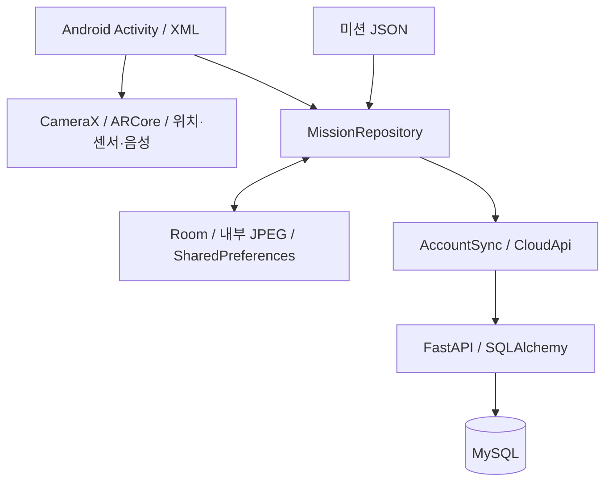
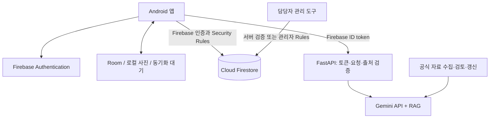
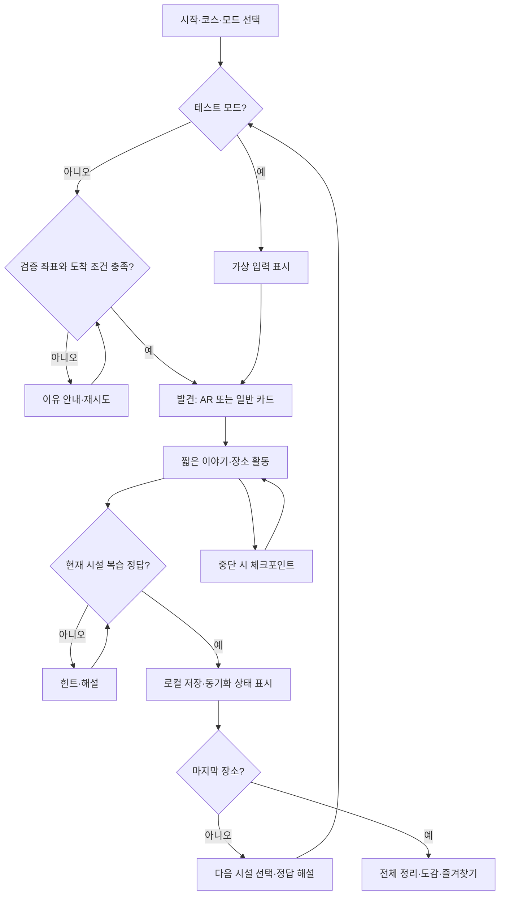
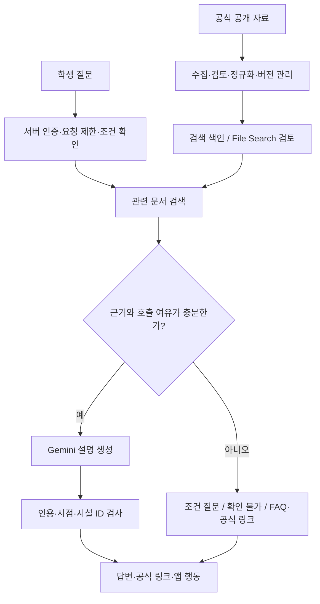

# 첫발자국 개발 현황·시스템 아키텍처·추진 계획 종합보고서

**작성일:** 2026-11-06 · **대상:** 팀 회의 및 개발 의사결정 · **버전:** 1.0

> 현재 코드·검증 기록과 향후 제안을 구분한다. 도식의 “목표/제안”은 구현 완료를 뜻하지 않는다. Markdown의 흐름도는 Mermaid 지원 뷰어에서 볼 수 있으며 PDF에는 완성된 도식으로 수록했다.

---

## 01. 보고서 요약

프로젝트 목적, 구현 상태, 피드백 반영 방향과 한 달 목표를 먼저 정리한다.

첫발자국
낯선 캠퍼스를 “필요할 때 찾아갈 수 있는 장소”로 바꾸는 탐방 앱

신입생·복학생이 건물의 위치뿐 아니라 시설의 역할과 이용 방법을 직접 관찰하고 기억하도록 돕는다. 사용자 본인을 주인공으로 삼고, 짧은 이야기·장소 활동·학습 퀴즈·기억 카드가 이어지는 경험을 만든다.

| 구분 | 보고서의 결론 |
| --- | --- |

| 현재 | Java/XML Android 앱, 기존 5미션, Room 저장, 시설 안내, FastAPI·MySQL 계정/완료 동기화 코드가 존재한다. |

| 핵심 보완 | 기존 센서 시연형 콘텐츠를 실제 건물의 학습 목표에 맞춰 재설계해야 한다. 현장 좌표와 AR 성공 검증은 남아 있다. |

| 목표 구성 | Firebase Authentication + Firestore, 기기 내 사진/Room, 서버를 통한 Gemini API + RAG를 무료 범위부터 검증한다. |

| 한 달 범위 | 대표 미션 완성 후 3~5개로 확장하고, 제한된 공식 자료 기반 챗봇과 최소 관리 기능을 조건부로 추가한다. |

| B2B 방향 | 학교 담당자가 콘텐츠를 관리하는 시범 도입용 MVP를 지향한다. 학교 전체 상시 운영·SSO·다대학 운영은 후속 단계다. |

### 회의에서 검토할 핵심 판단

- 4개 건물·5개 시설 후보 코스를 유지할지, 5개 건물로 조정할지 결정한다.

- 대표 건물의 자료와 현장 조건을 먼저 확보한다. 센서 사용 개수보다 활동의 이유와 완주 가능성을 우선한다.

- Firebase 전환으로 바뀌는 사진 복원·계정·동기화 정책을 정하고, 챗봇 확대는 핵심 탐방 진행 상황에 맞춘다.

> 상태 읽는 법: **구현**은 코드가 있는 상태, **검증**은 명시한 환경에서 확인한 상태, **제안**은 앞으로 만들 설계다. 구현 코드가 있다는 사실만으로 현장 성능이나 현재 서버 가동을 보장하지 않는다.

읽기 순서: 02~03 요구사항·제안 → 04 기술 스택 → 05~07 구조·탐방 흐름 → 08~09 이야기 → 10~11 챗봇·데이터 → 12~15 비용·계획·검증 → 16 근거 자료.

---

## 02. 목적과 요구사항

기능을 늘리는 기준은 “학생이 학교를 이해하고 다시 이용하는 데 도움이 되는가”이다.

| 영역 | 목표 및 요구사항 | 현재 판단 |
| --- | --- | --- |

| 대상 | 신입생·복학생 중심, 익숙하지 않은 시설을 찾는 재학생도 이용 | 사용자 범위 |

| 탐방 | 도착·발견·이야기·활동·복습·기록·다음 장소를 연결 | 핵심 개발 범위 |

| 시설 정보 | 공식 명칭, 역할, 주요 시설·층, 이용 방법, 출처와 확인 시점 | 공식 자료 + 현장 대조 필요 |

| 재사용 | 도감·시설 검색·즐겨찾기에서 탐방 후에도 안내 재확인 | 시설 화면 기반 있음, 확장 필요 |

| 챗봇 | 학교 전반의 공개 정보를 출처와 함께 설명, 시설·지도 연결 | Gemini RAG 설계 단계 |

| 비용 | 가능하면 무료 등급으로 개발·수업 시연 | 사진 로컬 저장 등 범위 조정 |

| B2B | 학교 담당자가 콘텐츠를 갱신하고 시범 운영하는 구조 | 중장기 지향점 |

### 현재 구현과 목표의 차이

기존 앱의 미션은 사진, 조도 가림·회복, 음성 빈칸, 방향 맞춤, 휴대전화 움직임이다. 교수 피드백을 반영한 도서관·진로·증명·보건 미션과 다음 시설 객관식 선택은 아직 코드에 반영되지 않았다. [L1, L2]

학교 전체 정보를 답하는 목표는 유지하되, 초기 챗봇은 검증한 자료의 범위를 명시한다. 개인 성적·시간표는 공개 자료로 알 수 없으며 학교가 허용하는 인증·API가 필요하다.

### 한 달 동안 제외하거나 축소할 범위

- 커뮤니티, 여러 대학 동시 운영, 계약·결제 관리, 학교 포털 SSO, 개인 학사정보 연동.

- OCR·자동 건물 판별, 걸음 수 측정, 모든 질문에 대한 정답 보장.

- AR가 불안정하면 일반 발견 카드로 대체한다. 실제 AR 성공으로 표현하지 않는다.

---

## 03. 피드백 반영 종합 제안

교수 피드백·팀원 전달 의견을 개발 의사결정과 검증 과제로 연결한다. 팀 승인 전 제안이다.

| 문제·피드백 | 종합 제안 의견 | 이유·검증 과제 |
| --- | --- | --- |

| 앱에서 무엇을 하는지 모호 | 대표 건물 한 곳의 시작부터 저장까지 먼저 완성 | 사용자가 한 행동과 배운 내용을 실제 APK로 설명 |

| 센서와 건물이 동떨어짐 | 시설 조사 후 활동을 정하고 센서를 선택 | 조도 손가림·폰 흔들기의 학습상 근거 재검토 |

| 건물 정보가 부족 | 시설 데이터에 역할·층·이용법·출처·확인 상태 추가 | 미확인 학과/층/좌표를 추정하지 않고 현장 대조 |

| 스토리 연결이 약함 | 하나의 큰 이야기와 건물별 생활 주제 구성 | 각 이동에 “다음 시설이 필요한 이유” 부여 |

| 마지막에 다음 건물 선택 | 시설 복습과 다음 목적지 문제를 구분 | 힌트·오답 해설 제공, 마지막 장소는 전체 정리 |

| 재사용성과 업데이트 필요 | 탐방 후 도감·즐겨찾기·공식 링크와 챗봇 제공 | 시설 콘텐츠 버전 관리, 변경·정정 확인 |

| 위치·AR 우려 | 대표 장소 조기 검증, 실패·권한 거절 대체 경로 | 좌표 실측, AR 추적 여부, 중단 후 재개 시험 |

| 목적 확장·빽빽한 발표 | 핵심 탐방 우선, 실제 화면과 핵심 결과 중심 | 챗봇은 안내 보조, 발표는 경험·근거·한계 분리 |

### 기존 기능의 처리 방향

| 유지 | 수정 | 보류·조건부 |
| --- | --- | --- |

| CameraX, Room, 도감, 기록 분리, 시설 검색 | 미션 콘텐츠·스토리·퀴즈, 데이터 모델, 계정/동기화 | 조도·흔들기 필수 관문, AR 필수화, 커뮤니티 |

| 일반 카드·문자 등 대체 입력 | 제안한 Firebase 이전 및 학교 자료 기반 챗봇 | 실기기·현장 성능 확정, 전교 상시 서비스 |

통합 피드백은 전달 내용과 검토 제안을 모은 자료이며 교수님의 최종 승인서가 아니다. 4건물·5시설 구성, 관리 화면과 챗봇 범위도 팀 결정이 필요하다. [L3]

---

## 04. 기술 스택

현재 소스에 선언된 버전과 앞으로 사용할 기술을 구분한다. 버전은 최신 권장값을 뜻하지 않는다.

| 계층 | 현재 기술·버전 | 역할 |
| --- | --- | --- |

| Android | Java 11 · XML Views · min SDK 24 / target·compile 37 | 실제 앱 코드와 화면 |

| 빌드 | AGP 9.4.1 · Gradle 9.6.0 | Android Studio 프로젝트 빌드 |

| UI | AppCompat 1.8.0 · Material 1.14.0 · ConstraintLayout 2.2.2 | Activity·뷰 구성 |

| 촬영·AR | CameraX 1.4.2 · ARCore 1.48.0 · OpenGL ES 2.0 | JPEG 촬영, 평면 앵커·오브젝트 경로 |

| 기기 내 저장 | Room 2.7.2 · SharedPreferences · 내부 JPEG 파일 | 완료 기록 / 미완료 체크포인트 / 사진 |

| 지도·기기 | OSM 타일·자체 View, Android 위치·센서 API, TTS·음성 인식 Intent | 지도 표시·도착 판정·상호작용 |

| 인증·통신 | Credential Manager 1.6.0 · Google ID 1.2.1 · HttpURLConnection | Google 경로 코드·JSON API |

| 서버 | Python 3.13.14 환경 · FastAPI 0.162.0 · Uvicorn 0.54.0 | 인증·완료 기록 동기화 API |

| DB·검증 | MySQL 8.0.43 · SQLAlchemy 2.1.6 · PyMySQL 1.2.3 · Pydantic 2.14.2 | 서버 저장·입력 검증 |

| 보안·사진 | Argon2 · google-auth · Android Keystore · Pillow | 비밀번호 해시·토큰·이미지 검사 |

| 테스트 | JUnit 4.13.2 · Espresso 3.7.0 · pytest 9.2.0 | 로직·Android·서버 검증 |

| 목표 기술 (미구현) | 적용 방향 |
| --- | --- |

| Firebase Auth + Firestore Spark | Google 로그인·계정별 텍스트 진행 기록과 즐겨찾기 |

| Gemini API + RAG / File Search 검토 | 공식 자료 검색·근거 기반 답변. 모델은 실제 무료 제공·평가 후 결정 |

| 기존 FastAPI 재사용 | Firebase 토큰 검증, 챗봇 중계, 자료 갱신·필요한 관리 처리 |

현재 구조는 Activity 중심 + Repository 분리다. MVVM·Compose·Retrofit·Firebase 기반으로 이미 구현됐다고 설명하면 안 된다. 출처: app/build.gradle.kts, gradle/libs.versions.toml, backend/requirements.txt. [L1]

---

## 05. 현재 시스템 아키텍처

현재 코드 구조. 외부 API·DB가 지금 실행 중이라는 의미는 아니다.

그림 1. 현재 논리 구조. 지도 View는 OSM 타일을 표시하며, 현장 미션 좌표는 아직 검증되지 않았다.

### 기기 저장과 서버 저장의 경계

- Room은 완료 기록, SharedPreferences는 미완료 단계·입력, 내부 파일은 사진을 맡는다. 성공 화면은 Room 저장 후 표시되며 서버 업로드 완료와 다르다.

- 계정 서버에는 완료 기록과 압축 JPEG를 동기화한다. 체크포인트·닉네임·시설 즐겨찾기는 현재 서버 동기화 대상이 아니다.

- 게스트와 로그인 계정은 기기 DB를 분리한다. 테스트(DEMO)와 현장(FIELD) 기록도 구분한다.

시설 8개는 별도 FacilityRepository에서 JSON을 읽어 화면에 표시한다. 현재 계정 연동 검증은 개발용 아이디·비밀번호 방식이다. Google client ID 미설정으로 Google 로그인은 비활성 상태이며, 학교 포털 인증은 미구현이다.

> 현재 가동 상태: 11/6 읽기 접속에서 로컬 MySQL과 API에 연결되지 않았다. 11/3 연동 검증 기록은 존재하지만, 상시 배포 서버가 마련됐거나 지금 서비스 중이라고 표현하지 않는다.

---

## 06. 목표 시스템 아키텍처

Firebase 무료 우선 + Gemini RAG. 전체 도면은 제안이며 실제 전환·연결 전이다.

그림 2. 목표 구조. 앱 사진은 Firestore에 올리지 않는다. 관리자 권한은 일반 사용자 권한과 분리한다.

### 무료 우선 구성에서 지켜야 할 경계

- Firestore는 메타데이터와 텍스트 기록, 사진은 기기 파일에 저장한다. 다른 기기로 완료 기록이 복원돼도 사진은 없을 수 있다.

- 기존 FastAPI를 챗봇·관리 처리에 재사용한다. Gemini 키와 관리자 자격 증명은 APK에 넣지 않는다.

- 클라이언트 Rules와 서버 검증은 각각 필요하다. 관리자 서버 접근이 일반 사용자 Rules를 대신한다고 가정하지 않는다.

Room을 유지하는 전환안에서는 로컬 상태와 Firestore 중 어느 상태가 기준인지, 중복·삭제·계정 전환 시 어떻게 처리할지 명시적으로 구현해야 한다. Firebase SDK 도입만으로 기존 데이터가 이전되지는 않는다.

---

## 07. 사용자 탐방 플로우차트

교수 피드백을 반영한 목표 흐름. 현재 앱의 다음 시설 선택 기능은 아직 미구현이다.

그림 3. 테스트 흐름과 실제 도착을 구분하고, 오답·미지원·중단에도 학습 흐름을 이어간다.

- 현재 앱 상태: DISCOVERY → STORY → GAME → (사진 미리보기) → QUIZ → SAVING → SUCCESS. 성공은 Room 저장 이후다.

- 목표 변경: 시설 기반 활동·퀴즈와 다음 시설 선택 추가. 새 미션은 데이터 버전을 분리해 이전 완료 기록과 혼동하지 않는다.

---

## 08. 스토리라인과 장소별 경험 Ⅰ

전체 이야기: 「처음엔 낯설었던 곳들」. 별도 인물 없이 사용자가 주인공이 된다.

> 처음에는 건물 이름만 보이던 지도에, 탐방하면서 “내가 여기서 할 수 있는 일”을 채워 넣는다. 시작은 낯섦, 진행은 관찰과 이해, 결말은 다시 찾아갈 수 있는 도감이다.

페르소나는 대상 사용자를 정의하는 설계 도구다. 앱 속 이야기는 학생이 겪는 상황과 장소의 연결이다. 자료 찾기 → 함께 공부하기 → 도움받기 → 생활 준비하기 → 나를 돌보기라는 하나의 주제를 따른다.

### 중앙도서관 | 스스로 찾아보는 힘

상황: “첫 과제에 필요한 자료를 찾아야 합니다. 학교에서 도움받을 방법을 찾아볼까요?”

| 활동·기능 | 배우는 것·완료 기준 |
| --- | --- |

| 공개 건물 표식 관찰, 허용 시 사진 촬영, 대출 안내 확인 | 자료 대출 기능과 창구 준비물을 이해한다. 사진/관찰 대체 활동 후 복습 정답으로 완료. |

| 복습: 창구 대출에 필요한 행동은? | 정답: 본인 신분증과 자료 제시. 사진 촬영 자체는 대출이나 건물 자동 인증이 아니다. |

| 다음 상황: 친구들과 자료를 펼치고 토론할 공간이 필요하다. | 보건진료소 / 황룡도서관 / 학생생활관 중 황룡도서관을 고르고 해설 확인. |

기억 카드: **자료 찾기**. 공식 대출 안내와 관찰 기록을 저장한다. [S1]

### 황룡도서관 | 함께 배우는 공간

상황: “혼자 집중할 때와 함께 토론할 때는 필요한 공간이 다릅니다. 팀플할 공간을 찾아보세요.”

| 활동·기능 | 배우는 것·완료 기준 |
| --- | --- |

| 공개 안내도에서 그룹스터디룸과 이용 안내 찾기 | 학습 목적에 맞는 공간 선택. 안내 확인과 복습 정답으로 완료. 예약·입실은 완료 조건 아님. |

| 다음 상황: 공부할 공간을 알아두었지만 진로 준비가 막막하다. | 대학일자리플러스센터 / 보건진료소 / 학생생활관 중 지원 기능에 맞는 곳 선택. |

기억 카드: **함께 공부하기**. 정숙 공간에서는 음성·흔들기 조작을 요구하지 않는다. 두 도서관 방문의 가치와 이동 부담은 현장에서 검토한다. [S2]

---

## 09. 스토리라인과 장소별 경험 Ⅱ

후보안은 4개 건물 안의 5개 시설 미션이다. 시설의 공식 정보와 현장 상태를 대조해야 한다.

### 제2학생회관 | 혼자 해결하지 않아도 되는 일

같은 건물에서 진로 지원과 생활 행정이라는 두 가지 도움을 알아본다. 대학일자리플러스센터는 공식 안내상 2층, 자동증명발급기는 1층이다. 실제 안내판·출입 동선·현재 설치 상태는 확인 전이다. [S3, S4]

| 미션 | 사용자 활동 | 완료·다음 연결 |
| --- | --- | --- |

| 방향 찾기 | 센터 안내에서 진로·취업 상담 또는 관련 프로그램을 선택한다. 외부 발화 가능 장소의 문의 연습은 선택 활동이다. | 지원 기능 복습 정답. 실제 상담 신청·예약 완료로 표시하지 않는다. |

| 학교생활 준비하기 | 재학증명서 상황에 맞는 방문/인터넷 발급 경로를 찾고 공식 안내를 저장한다. | 발급 방법 복습 정답. 로그인·결제·출력 없이 완료한다. |

연결 문구: “학교의 도움은 상담만 있는 게 아니에요. 필요한 서류를 준비할 방법도 알아볼까요?” → “건강에 관한 도움이 필요할 때 찾아볼 곳은 어디일까요?”

### 제1학생회관 | 나를 돌보는 학교생활

상황: “공부하고 준비하는 것만큼 내 상태를 살피는 것도 학교생활의 일부입니다.” 공개 안내에서 보건진료소의 위치와 건강상담 등 서비스를 알아본다. 공식 안내상 제1학생회관 2층이며 현장 확인은 별도다. [S5]

완료 조건은 서비스 이해를 확인하는 복습 정답이다. 진료·증상 입력·환자나 의료 기록 촬영은 요구하지 않는다. **나를 돌보기** 기억 카드를 얻고 전체 도감으로 마무리한다.

### 엔딩과 재사용

> “처음에는 이름만 알던 건물에 이제는 찾아갈 이유가 생겼어요. 오늘의 탐방은 끝났지만, 여러분의 학교생활은 여기서 이어집니다.”

완료한 지도·도감에서 시설 기능, 공식 이용 안내, 허용된 개인 사진을 다시 확인한다. 시설 검색·즐겨찾기와 챗봇은 탐방을 다시 처음부터 수행하지 않아도 사용할 수 있도록 설계한다.

마지막 장소는 다음 건물 문제를 생략하고 전체 정리로 끝내는 안이다. 5개 건물 구성이 필요하면 실제 수업 건물 등을 조사해 코스를 조정하며 건물 수만 맞추기 위한 장소는 추가하지 않는다.

---

## 10. Gemini RAG 아키텍처·플로우

학교 정보를 질문 시점에 찾아 설명한다. 수집·검색·생성·검증은 각각 구현해야 한다.

그림 4. 학교 홈페이지 자동 학습·자동 갱신이 API 연결만으로 완성되는 것은 아니다.

| 답변 품질 기준 | 개발 원칙 |
| --- | --- |

| 출처·시점 | 원문 URL, 문서 적용 학기/날짜, 수집 시점을 구분한다. 생성한 임의 링크는 출처로 쓰지 않는다. |

| 모르는 질문 | 학과·입학 연도가 필요한 질문은 조건을 묻는다. 개인 성적·장학 결과는 추측하지 않는다. |

| 갱신·오류 | 폐기·정정 문서 제거, 무료 호출 제한·검색 실패 시 공식 자료 안내로 전환한다. |

| 범위·차별점 | 학교 AI 하루 도입 공지가 존재한다. 첫발자국은 시설·지도·탐방에 연결하며 기존 API 공개 여부는 미확인이다. |

현재 Gemini 의존성·챗봇 API·수집기는 미구현이다. 무료 등급의 실제 모델·한도는 계정에서 확인한다. 학교 데이터 기반 답변이 오류를 완전히 없애는 것은 아니다. [S6, S8]

---

## 11. 데이터 모델과 이전 계획

현재 MySQL의 완료·사진 동기화에서 Firebase 텍스트 동기화로 바뀌는 계약을 명확히 한다.

| 현재 저장 위치 | 내용·동작 |
| --- | --- |

| Room / 내부 JPEG | 계정별 DB, (mode, missionId) 완료 고유키. 사진은 내부 파일 경로로 연결. |

| SharedPreferences / Keystore | 미완료 체크포인트·모드·닉네임, 암호화된 세션. 시설 즐겨찾기는 현재 기기 공통이다. |

| MySQL 6개 테이블 | users / tokens / google_challenges / mode_states / missions / completions. 사진은 MEDIUMBLOB으로 저장한다. |

| 현재 동기화 | 진행 조회 → generation 비교 → 서버에 없는 완료·사진 전송 → 스냅샷 반영. 상시 자동 재시도 큐는 없다. |

### 목표 Firestore 모델 예시 (제안)

| 컬렉션·문서 | 핵심 데이터 |
| --- | --- |

| facilities/{facilityId} | 공식 명칭·역할·층·출처 URL·검증 상태·공개 버전 |

| courses/{courseId}/missions/{missionId} | 시설 ID·학습 목표·이야기·활동 종류·퀴즈·순서·콘텐츠 버전 |

| users/{uid}/completions/{key} | mode + courseVersion + missionId, 완료 시각·발견/조작 수단·동기화 상태 |

| users/{uid}/favorites/{facilityId} | 즐겨찾기. 본인 UID 범위에서만 접근 |

| sourceDocuments/{sourceId} | 공식 URL·문서 시점·수집 시점·버전·공개 상태. 학교 공개 문서 관리 |

### 변경·이전 순서

- ① 현재 로컬·서버 기록을 보존하고 새 미션의 버전과 Firebase UID 매핑 정책을 정한다.

- ② Firebase 로그인·Rules·사용자별 기록을 개발 환경에서 검증한다. 기존 이메일만 보고 다른 계정의 기록을 합치지 않는다.

- ③ Room에 완료·동기화 대기를 남기고 같은 완료 키로 재전송해 중복을 막는 처리를 추가한다. 초기화 세대 처리도 유지한다.

- ④ 기기 간 텍스트 기록 복원, 계정 전환, 오프라인 저장, 삭제 뒤 오래된 기록 재등장 방지를 확인한 뒤 이전한다.

> 중요한 기능 차이: 현재 MySQL 경로는 사진 복원을 포함하지만, 무료 우선 Firebase 제안은 사진을 기기에만 둔다. 원격 완료 기록에 사진이 없을 때의 표시·삭제·내보내기 정책을 별도로 정해야 한다.

---

## 12. 무료 우선 운영·비용 계획

개발·수업 시연에서 결제 없이 검증하는 구성을 우선하며, 상시 학교 배포는 별도 운영 과제다.

| 항목 | 목표 구성 | 운영상 한계 |
| --- | --- | --- |

| 로그인 | Firebase Auth Google 로그인 | 프로젝트·OAuth 설정과 실제 로그인 시험 필요. 학교 포털 인증은 아님. |

| DB | Firestore Spark 무료 등급 | 조회·저장 한도. 매 화면 전체 목록 재조회·불필요한 리스너 최소화. |

| 사진 | 앱 내부 파일 + Room | 클라우드 사진 복원 없음. 기기 데이터 삭제·교체 시 유실 가능성을 안내. |

| 챗봇 | 무료 지원 Gemini 모델 + RAG | 모델·계정별 호출 한도. 한도 소진 시 FAQ·공식 링크 제공. |

| 서버 | 팀 PC FastAPI | PC·네트워크 가용성에 의존. 상시 서비스로 운영하려면 별도 호스팅·관리 필요. |

| 지도·자료 | 현재 OSM 지도와 공식 링크 | 출처 표기·서비스 이용 조건 준수, 최신 자료 갱신 필요. |

### 현재 확인한 무료 범위와 제외 항목

- Firestore Standard 무료 기준: 저장 1 GiB, 하루 읽기 50,000회·쓰기 20,000회. 프로젝트 단위 사용량이며 특정 사용자 수의 서비스 가능성을 보장하지 않는다. [S7]

- Cloud Storage와 배포형 Cloud Functions는 Spark 구성에서 제외한다. Blaze 무료 사용량과 “결제 계정 없이 사용”은 구분한다. [S7]

- Gemini 가격표에는 File Search Free Tier가 표시돼 있다. 실제 계정의 모델·도구 제공 여부·용량·호출 한도를 확인한 후 적용한다. [S8]

- 무료 Gemini에는 공개 학교 자료 중심으로 입력한다. 무료 등급의 제품 개선 데이터 이용 조건을 고려해 민감한 학생 정보를 보내지 않는다. [S8]

### 비용과 장애를 줄이는 구현

질문 길이·응답 길이·사용자별 요청 빈도를 제한하고, 같은 자료의 반복 질문은 콘텐츠 버전에 맞춰 캐시한다. 수집은 변경된 공식 문서 위주로 갱신한다. API 제한·네트워크 실패를 별도 상태로 안내하고 탐방·도감은 계속 사용할 수 있게 한다.

가격·정책은 11/5 공식 문서 확인 기록에 근거한다. 활성화 시 실제 계정 요금제와 최신 조건을 다시 확인한다. 유료 전환이나 결제 계정 연결은 이 보고서 작업에서 수행하지 않았다.

---

## 13. 한 달 개발 계획과 완료 기준

4주 일정은 자료·현장·기기 확보를 전제로 한 계획 추정이다. 기능 수보다 완성된 대표 흐름을 우선한다.

| 기간 | 핵심 작업 | 완료 기준·지연 시 조정 |
| --- | --- | --- |

| 1주차 | 건물 정보·동선·학습 목표 확정. 대표 미션 1개를 새 이야기로 구현. GPS·카메라·AR 기술 위험 조기 확인. | 시작→관찰→활동→퀴즈→로컬 저장→재개 확인. AR가 막히면 카드 경로로 완주 보장. |

| 2주차 | 검증된 장소로 3~5미션 확장. 다음 시설 선택. Firebase 로그인·기록 분리·동기화 구현. | 본인 기록만 조회, 테스트/현장 분리, 오프라인·계정 전환·기기 재실행 검증. |

| 3주차 | 제한된 공식 자료 RAG와 출처 UI. 최소 콘텐츠 관리 기능. 실제 질문과 사용자 시험. | 근거 있는 답변·모르는 질문·한도 초과 처리. 시설 정보 수정 후 검토·공개 가능. |

| 4주차 | 신규 기능 확대 중단. 현장·사용자 검증, 오류 수정, APK·발표 자료 정리. | 대표 시나리오와 실패·복원 흐름 통과. 실제 화면·검증 범위·남은 한계 제시. |

### 담당 영역과 필요한 산출물

| 담당 영역 (인원 미정) | 필요 산출물 |
| --- | --- |

| 콘텐츠·현장 조사 | 건물 정보표, 출처, 사진 허용 구역·실측 좌표·동선 확인 |

| 앱·기기 기능 | 활동·퀴즈·화면·권한·대체 입력·중단 복원 |

| 인증·데이터·챗봇 | Firestore Rules·이전·서버 인증·자료 색인·답변 출처 |

| 통합 검증·발표 | 사용 시나리오, 오류 기록, 실제 APK 화면, 제한 사항 |

> 진행 기준: 대표 탐방이 안정화되지 않으면 챗봇 자료 범위와 관리자 기능을 축소한다. 학교 전체 지식 수집이나 커뮤니티 개발 때문에 핵심 미션 완성을 늦추지 않는다.

한 달의 성공 기준은 “학교 시범 도입을 제안할 수 있는 MVP”다. 계약, 학교 시스템 연계 승인, 다대학 운영·결제, 운영 책임·상시 장애 대응까지 완료한 B2B 서비스로 표현하지 않는다.

---

## 14. 검증 현황과 실제 APK 화면

같은 실행의 결과처럼 합산하지 않고 검증 날짜·환경·범위를 구분한다.

| 시점·근거 | 확인 결과 | 해석 한계 |
| --- | --- | --- |

| 11/5 최신 결과 XML | 단위 40개 / VisualToolsTest 계측 2개 통과. Lint 오류 0·경고 94. | 전체 계측·서버 테스트를 같은 날 재실행한 결과가 아님. |

| 11/3 원시 계측 기록 | 서버 인증·사진 복원·계정 분리 관련 8개 통과. | 과거 실행. 현재 서버 가동 여부와 다름. |

| 11/3 백엔드 문서 | 실제 MySQL 테스트 22개 통과 기록. | 별도 원시 성적서 미확인. 최신 재검증 아님. |

시설 검색 실제 화면

CameraX 실제 촬영 화면 - 피사체는 가상 방

OSM 실제 지도 화면 - 위치는 가상 좌표

### 아직 검증하지 못한 것

API35 AR 초기화 실패, API33 카메라 프레임 문제·빈 화면으로 추적 성공은 미확인이다. 현장 GPS·센서·출입·촬영 조건도 남아 있다. iPhone+Camo 연결 후 실제 카메라 입력이 에뮬레이터에서 인식되는지 별도 검증해야 한다. [L4]

현재 모든 미션 좌표는 미검증이므로 FIELD 시작이 차단된다. 실제 APK 화면은 에뮬레이터에서 확보 가능하지만, 가상 입력을 현장 실측·실제 캠퍼스 촬영으로 제시하지 않는다.

---

## 15. 위험 관리와 확장 판단

피드백 반영, 한 달 완성, 대학 시범 운영을 연결하는 의사결정 기준이다.

| 위험 | 대응 제안 | 확인 기준 |
| --- | --- | --- |

| 시설 정보·동선 미확정 | 대표 건물 조사와 안전한 공개 구역부터 확정 | 출처·확인일·좌표·표지·접근 조건 기록 |

| 센서 사용 목적이 약함 | 활동이 학습에 기여하지 않으면 수정 또는 선택 기능화 | 학생이 무엇을 배웠는지 설명 가능한가 |

| AR·GPS 기기 차이 | 초반 기술 검증, 일반 카드·문자 등 대체 흐름 유지 | 오류에도 탐방 완주, 검증 방식 구분 |

| Firebase 이전 중 기록 손실 | 기존 데이터 보존·UID 매핑·버전 분리·복원 시험 | 계정 혼합·중복 완료·삭제 후 기록 부활 방지 |

| 챗봇 오류·오래된 정보 | 출처·시점·조건 확인, 잘못된 전제·자료 충돌 평가 | 틀린 내용을 확신해 안내하지 않는가 |

| 무료 한도·PC 서버 중단 | 요청 제한·캐시·FAQ, 오프라인 탐방 지원 | 챗봇 실패가 미션 진행을 막지 않는가 |

| 범위 과다·B2B 과장 | 이번 달 MVP와 기관 운영 기능을 단계 구분 | 시범 사용 결과로 다음 투자·협의 결정 |

### 시범 운영 다음 단계

학교 담당자와 시설 정보 갱신 책임, 공개 승인, 학생 문의 창구를 정한다. 개인정보 처리·보존·삭제, 데이터 백업, 서버 가용성·사용량 관리, 학교 연동 API 제공 가능성을 확인한 후 실제 배포 범위를 넓힌다. 현재 해당 협의나 운영 체계가 확보된 것은 아니다.

### 회의에서 확정할 제안

- 스토리 「처음엔 낯설었던 곳들」, 4건물·5시설 후보 코스와 대표 미션.

- 과목의 필수 센서 평가 항목, 현장 답사·Android 기기 확보 담당과 일정.

- Firebase 무료 전환과 사진 기기 보관 정책, 챗봇 1차 지식 범위.

- 역할·일정·주차별 통과 기준. 지연 시 축소할 기능의 순서.

---

## 16. 근거 자료와 보고서 범위

보고서 작성 중 앱 기능이나 DB를 변경하지 않았다. 문서·그림은 현재 감사 결과와 제안을 종합한 것이다.

### 로컬 근거

[L1] **현재 소스·버전** — app/build.gradle.kts; gradle/libs.versions.toml; backend/requirements.txt; backend/app.py

[L2] **미션·저장·동기화** — app/src/main/assets/missions.json; data/MissionRepository.java; data/AccountSync.java; MissionCheckpointStore.java

[L3] **통합 피드백** — docs/첫발자국_제안_중간발표_통합피드백.md

[L4] **11/5 시각 검증·사진** — docs/verification/2026-11-05/README.md 및 같은 폴더 PNG

[L5] **테스트 기록** — app/build/test-results/testDebugUnitTest; app/build/outputs/androidTest-results; app/build/reports/lint-results-debug.txt

[L6] **과거 서버 검증** — docs/backend-api.md; .local/android-server-tests.txt

[L7] **제안·회의 자료** — docs/첫발자국_교수피드백_미션재설계안.md; docs/첫발자국_학교생활_챗봇_설계안.md

로컬 근거의 기준 경로: C:/Users/InsuHam/FirstStep. Java 파일의 생략 경로는 app/src/main/java/com/example/firststep 아래다. 기준 HEAD는 af0d3a2이며 후속 미커밋 변경을 포함해 확인했다.

### 공식 참고 자료

- [S1] [국립군산대학교 도서관 자료 대출·반납](https://library.kunsan.ac.kr/main/sub.php?mno=35)

- [S2] [국립군산대학교 도서관 시설·이용시간](https://library.kunsan.ac.kr/main/sub.php?mno=36)

- [S3] [국립군산대학교 대학일자리플러스센터](https://www.kunsan.ac.kr/job/index.kunsan)

- [S4] [국립군산대학교 제증명발급](https://www.kunsan.ac.kr/index.kunsan?menuCd=DOM_000000103007002000&sso=ok)

- [S5] [국립군산대학교 보건진료소](https://www.kunsan.ac.kr/index.kunsan?menuCd=DOM_000000105006005000&sso=ok)

- [S6] [국립군산대학교 AI 하루 도입 공지](https://www.kunsan.ac.kr/comcenter/board/view.kunsan?boardId=BBS_0000534&dataSid=1344698&menuCd=DOM_000003805001000000)

- [S7] [Firebase 가격·무료 등급](https://firebase.google.com/pricing)

- [S8] [Gemini 가격·File Search·한도](https://ai.google.dev/gemini-api/docs/pricing)

- [S9] [Gemini File Search 문서](https://ai.google.dev/gemini-api/docs/file-search)

학교 정보와 서비스 정책은 2026-11-05 조사 기록을 사용했다. 적용 시 최신 공식 내용과 실제 계정 조건을 재확인한다. 본 보고서의 일정·구성·활동 예시는 팀 검토 제안이며 교수 승인 또는 학교 도입 확약을 뜻하지 않는다.
